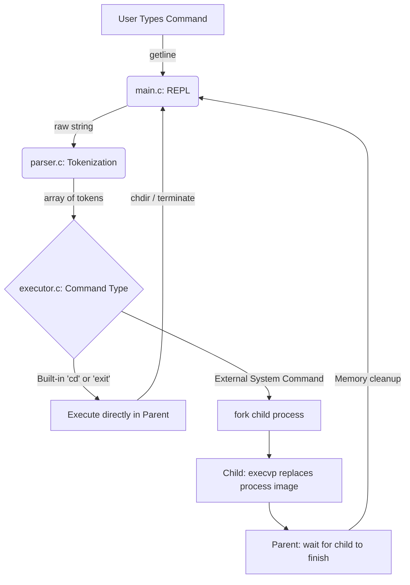

# myshell: POSIX-Compliant Command-Line Interface

## 📖 Project Overview

`myshell` is a custom UNIX-style command-line shell written entirely in C. Developed as a capstone project for Harvard's CS50x, it implements a complete Read-Evaluate-Print-Loop (REPL), dynamic input tokenization, and system-level process management utilizing standard POSIX system calls. 

This project explores the architecture of bare-metal operating system interactions, specifically focusing on dynamic memory allocation, pointer arithmetic, and process concurrency (`fork()`, `execvp()`, `wait()`).

## 🖥️ Visual Proof

Below is a demonstration of `myshell` compiling via `make`, executing standard system commands, managing directories, and gracefully terminating[cite: 2]:

#### Video Demo: <https://www.youtube.com/watch?v=pWYWXD3LPuw>

## ⚙️ Core Tech Stack

*   **Language:** C (Standard: C11 / POSIX.1-2008)
*   **Compiler:** GCC (GNU Compiler Collection)
*   **Build System:** GNU Make
*   **Environment:** macOS / Linux (POSIX-compliant systems)

## ✨ Key Features

*   **Custom REPL:** A robust Read-Evaluate-Print-Loop that dynamically allocates memory for user input of any length.
*   **Process Forking:** Utilizes `fork()` and `execvp()` to execute external system programs (like `ls`, `mkdir`, `pwd`) in child processes without crashing the parent shell.
*   **Built-in Commands:** Intercepts specific commands like `cd` (utilizing `chdir()`) and `exit` to run directly within the parent process.
*   **Memory Safety:** Strict cleanup routines using `free()` to prevent memory leaks during execution and upon termination.

## 🏗️ Architecture Diagram

The following workflow illustrates how `myshell` processes a command from input to execution:

📂 Repository Structure
The project is modularized to separate the REPL, lexical analysis, and process execution:
project/
├── src/
│   ├── executor.c     # Handles process forking and system calls
│   ├── main.c         # Core Read-Evaluate-Print-Loop (REPL)
│   ├── parser.c       # String tokenization and formatting
│   └── shell.h        # Shared function prototypes and libraries
├── test_dir/          # Sandbox directory for command testing
├── Makefile           # Automated build configuration
├── myshell            # Compiled executable
└── README.md          # Project documentation

📝 About the Components
main.c: The entry point. Prints the myshell> prompt, fetches dynamic user input from stdin, and routes the data through the parser and executor.
parser.c: Slices the raw input string into distinct, executable tokens using strtok, formatting the data exactly as required by the execvp system call.
executor.c: The control center. It evaluates whether a command is built-in or external, handles the fork() cloning process, and synchronizes parent/child states.
shell.h: The header file linking the architecture together, containing standard library includes and global function prototypes.
Makefile: Automates compilation using gcc with strict flags (-Wall -Wextra) to enforce code quality.
🚀 Local Setup & Execution
To run myshell on your local POSIX-compliant machine (macOS/Linux), follow these steps:
Clone the repository:
git clone [https://github.com/HAMED-PAYANDA/myshell.git](https://github.com/HAMED-PAYANDA/myshell.git)
cd myshell
Compile the source code:
Bash
make
Execute the shell:
Bash
./myshell
📄 License
This project is licensed under the MIT License - see the LICENSE file for details.
👤 Author
Hamed Payanda
GitHub: @HAMED-PAYANDA
Completed as part of the Harvard CS50x Capstone Project.
