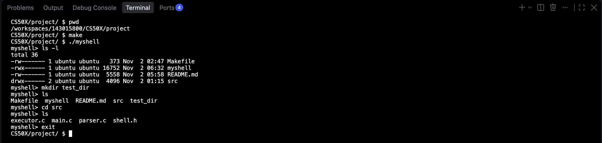
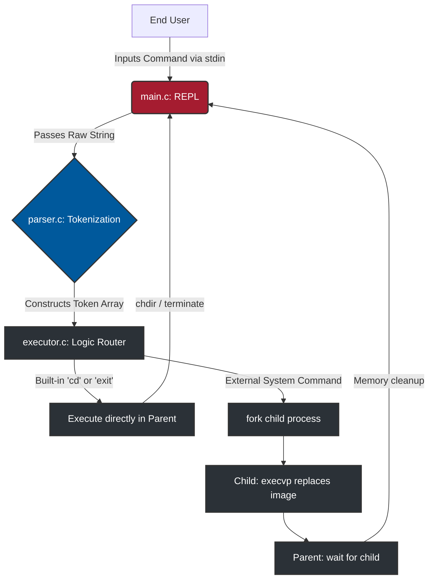

# 🐚 myshell: POSIX-Compliant Command-Line Interface

[](https://cs50.harvard.edu/x/)


## Overview

This project provides a custom UNIX-style command-line shell written entirely in C. Developed as a capstone project for Harvard's CS50x, it implements a complete Read-Evaluate-Print-Loop (REPL), dynamic input tokenization, and system-level process management. The application features a robust execution pipeline utilizing standard POSIX system calls to manage process concurrency, directory navigation, and external program execution without crashing the parent environment. Additionally, the suite includes automated compilation and testing via a custom Makefile and continuous integration pipeline.

---

## 📸 Visual Proof & Demos

Here is a look at the custom shell in action:

### 1. Terminal Execution & Process Management
*Demonstrates compilation via GNU Make, executing standard system commands, managing directories, and gracefully terminating without memory leaks.*[cite: 2]


---

## 🏗️ Architecture Diagram

The application suite follows a modular architecture, utilizing distinct C files to separate the REPL logic, lexical analysis, and low-level system call execution. 


---

## ✨ Key Features
Dynamic Memory Allocation: Utilizes getline to dynamically allocate heap memory for user inputs of unpredictable lengths, bypassing rigid static array limitations.
Process Cloning (Forking): Protects the main shell from terminating by using fork() to clone the current process before executing external commands.
Process Image Replacement: Leverages execvp() to search the system's PATH and completely replace the child's memory image with the requested program.
Built-in Command Interception: Bypasses standard child process isolation by intercepting cd and exit strings, routing them to run directly within the parent process using chdir().
Strict Memory Safety: Implements rigorous free() routines on all dynamic buffers and token arrays to ensure zero memory leaks during execution and upon termination.
Modular Architecture: Designed with independent .c files for distinct tasks (main loop, parsing, execution), allowing for high maintainability.
Automated CI/CD: Integrated GitHub Actions workflow automatically compiles the codebase and verifies the binary status on every push.

---

## 🧰 Core Tech Stack
Category	Technology / Tool	Version / Standard
Language	C	C11 / POSIX.1-2008
Compiler	GCC (GNU Compiler Collection)	-
Build System	GNU Make	-
Target Environment	macOS / Linux	POSIX-compliant
Memory Management	Native C	malloc, free, getline
DevOps & CI/CD	GitHub Actions	ubuntu-latest

---

## 📂 Repository Structure
```text
Plaintext
.
├── .github/
│   └── workflows/
│       └── ci.yml             # CI/CD Pipeline Configuration
├── project/                   # Core Project Directory
│   ├── src/                   # Source Code Files
│   │   ├── executor.c         # Script: Process forking and system calls
│   │   ├── main.c             # Script: Core REPL and input handling
│   │   ├── parser.c           # Script: String tokenization logic
│   │   └── shell.h            # Header: Function prototypes and includes
│   ├── test_dir/              # Directory: Sandbox for command testing
│   ├── Makefile               # Build Configuration
│   ├── myshell                # Compiled Executable Binary
│   └── README.md              # Project Documentation
└── .gitignore                 # Ignored files (executables, object files)
```
(Reference: Internal File Structure)
---

## 💻 Local Setup & Execution
Want to compile and run this custom shell on your own machine? Follow these steps:
1. Clone the repository
```bash
git clone [https://github.com/HAMED-PAYANDA/myshell.git](https://github.com/HAMED-PAYANDA/myshell.git)
cd myshell/project
```
2. Compile the source code
The custom Makefile is configured to compile the source files inside the src directory with strict warnings (-Wall, -Wextra).
```bash
make
```
3. Launch the Shell
Execute the newly generated binary to enter the REPL:
```bash
./myshell
```
4. Test System Commands
You can now interact with the shell just like your standard terminal. Try the following standard UNIX commands:
```bash
myshell> ls -l
myshell> mkdir testing_directory
myshell> cd src
myshell> pwd
myshell> exit
```
---

## 📄 License

This project is licensed under the MIT License - see the [LICENSE](LICENSE) file for details.

---

## 👤 Author

**Hamed Payanda**
* **GitHub:** [@HAMED-PAYANDA](https://github.com/HAMED-PAYANDA)
* Completed as the **Capstone Project for the Harvard CS50x Program**.


